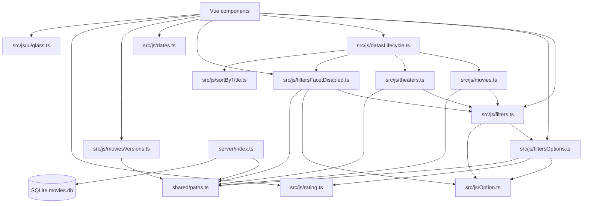

# TypeScript dependency map

Scope: handwritten `.ts` files and TypeScript in Vue `<script setup>` blocks under `src/`, plus `server/index.ts` and `shared/paths.ts`. Generated declarations, styles, and the large static SVG/map data are excluded. `HelloWorld.vue` is included as currently unmounted starter code.

## Module flow

## Variables and functions

Arrows mean “reads, calls, or is computed from”. External inputs such as Vue, `fetch`, `URLSearchParams`, `Intl.Collator`, and the database are named where relevant.

### `shared/paths.ts`

- `API_PORT`: standalone constant, consumed by the server listener.
- `API`: endpoint constants, consumed by frontend request functions and the server route.

### `src/js/Option.ts`

- `Option`: type only; `value: string`, `label: string`, optional `img: string`. No runtime dependencies.

### `src/js/filtersOptions.ts`

- `theaters`: static option list → default `options` export and filter UI.
- `ratings`: static option list → calls `r2src` to populate optional images → `options` and filter UI.
- `dates`, `versions`: Vue refs initialized with the “不限” option → `start` writes fetched options → UI and `Filters.toLabel` read them.
- `fetchVersionsOrDates(url)`: `url` → `fetch` → response JSON strings → `Option[]`; throws on non-OK response.
- `start()`: `API.versions`, `API.dates` → parallel `fetchVersionsOrDates` calls → writes `versions` and `dates`.
- default `options`: Vue `reactive` wrapper around `theaters`, `ratings`, `dates`, `versions`.
- Type dependency: `Option` from `Option.ts`; runtime dependency: `r2src`, Vue, `API`.

### `src/js/filters.ts`

- `Filters.theater/movie/rating/date/version/city`: mutable string state; empty string is each field’s default.
- `Filters.toString()` → fields plus `toLabel()` → `options.ratings`, `options.dates`.
- `Filters.toLabel(from, value)` → searches `from` by `Option.value`, returns `Option.label`.
- `Filters.allDefault()` → `FILTER_KEYS` → `notDefault()`.
- `Filters.notDefault(colName)` → this filter field + `DEFAULTS[colName]`.
- `Filters.reset()` → `DEFAULTS` via `Object.assign`.
- `Filters.resetCol(colName)` → `DEFAULTS[colName]`.
- `FILTER_KEYS` → `FilterKey` union → `allDefault`, `fetchFacets`.
- `DEFAULTS` → new `Filters`; used by defaults checks and reset operations.
- `filters` → Vue `reactive(new Filters())`; shared mutable state observed by components and API callers.
- `ALL` (`'all'`) → UI-compatible representation for empty selection.
- `theater_get_set`, `rating_get_set`, `date_get_set`, `version_get_set`: Vue computed getter/setters → `filters` plus `withAll`/`fromAll`.
- `filters_get_set` → Vue `reactive` wrapper around those four computed properties → select controls.
- `withAlls(from)` → `Option[]` copy where empty values become `ALL`.
- `fromAlls(from)` → `Option[]` copy where `ALL` becomes empty string.
- `withAll(value)` / `fromAll(value)` → convert between UI sentinel and domain default.
- Type dependency: `Option` from `Option.ts`; runtime dependency: Vue and `options`.

### `src/js/filtersFacetDisabled.ts`

- `Facets` → `FilterKey` → keys correspond to server facet response fields.
- `fetchFacets(f?)`: optional `Filters` → `FILTER_KEYS` + `notDefault` → query string → `API.facet` + `fetch` → `Facets`.
- `withDisabled(from, colName)`: options + `facets` + `ALL` → copies options and assigns `disabled`; compares theater by label, other fields by value.
- `Option` type dependency from `Option.ts`; `facets` runtime dependency from `datasLifecycle.ts`.

### `src/js/datasLifecycle.ts`

- `movies`: fetched movie list → sorted by `compareTitles`; optional client-side rating/title filters applied in `update`; rendered by `HomePage`.
- `moviesOptions`: snapshot of the fetched/sorted/rating-filtered movies before title matching → movie autocomplete.
- `allMovies`: initialized empty; `start()` fetches all movies into it; currently no other reads found.
- `theaters`: `fetchTheaters` output → exported lifecycle state; currently not read by components.
- `facets`: `fetchFacets` output → `withDisabled`.
- `loading`: true around `start`/`update` async work → `HomePage` loading branch.
- `start()`: fetches movies, theaters, facets; sorts movies; initializes `moviesOptions` and `allMovies`.
- `update(filters)`: fetches filtered movies/theaters/facets; sorts, optionally filters rating/title, refreshes `moviesOptions`.
- default lifecycle object → `{ start, update, movies, theaters, loading }`; `HomePage` imports named bindings instead.
- Runtime dependencies: Vue `ref`, `fetchMovies`, `fetchTheaters`, `fetchFacets`, `compareTitles`.

### Data access and utilities

- `src/js/movies.ts`: `Movie` is the response shape. `fetchMovies(f?)` → `Filters.notDefault` for theater/date/version → query string + `API.movies` → `fetch` JSON → `Movie[]`.
- `src/js/theaters.ts`: `Theater` is the response shape. `fetchTheaters(f?)` → `Filters.notDefault('city')` → query string + `API.theaters` → `fetch` JSON.
- `src/js/moviesVersions.ts`: `getVersions(movie_id, theater_name?)` → query parameters → `API.movie_versions` → `fetch` JSON string list. Used by `MovieCard`.
- `src/js/rating.ts`: `rating2srcMap` → `r2src(rating)`; `r2src` validates the key and creates an asset URL, or returns `undefined`. Used by `filtersOptions` and `MovieCard`.
- `src/js/sortByTitle.ts`: `latin`, `zhuyin` collators + `isLatin(title)` → `compareTitles(a,b)`; used by lifecycle sorting.
- `src/js/dates.ts`: `pad` → `to_mm_dd` → `toDate`; `isSameDay` also uses parsed dates. `dateLabel` → `toDate`, `isSameDay`, `to_mm_dd`; used by `DockOpen`.
- `src/js/ui/glass.ts`: `ease` and `glassUi` are style string constants; `glassUi` is consumed by `DockOpen`.

### Vue entry points and component state

- `src/main.ts`: `createApp` + `App` + UI plugin + style imports → mount at `#app`.
- `src/App.vue`: `HomePage` → wrapped by Nuxt UI `UApp`.
- `src/components/HomePage.vue`: `onMounted(start)`; `watch(filters, update)`; renders `movies`/`loading`; passes each movie to `MovieCard`; mounts `Header_` and `DockOpen`.
- `src/components/DockOpen.vue`: `open` → panel visibility/inert state. `currentRating` → `options.ratings` + `filters.rating`. `onMounted(start)` loads date/version options. Template reads/updates `filters`, `filters_get_set`, `withAlls`, `withDisabled`, `moviesOptions`, `dateLabel`, `glassUi`, `options`.
- `src/components/MovieCard.vue`: `props.movie` → `runtime` formatting; `getVersions(movie.id, filters.theater)` → `versions`; `posterFailed` → poster fallback; `r2src(movie.movie_rating_system)` → rating image; renders movie fields.
- `src/components/Header_.vue`: `activeTab` → `isTab(tab)` and `switchTab(tab)`; `badge` is initialized but no read/update is present in the inspected script/template.
- `src/components/HelloWorld.vue` (starter, not mounted by `App.vue`): `count` state is used by its demo counter; imported hero/Vite/Vue images are displayed.

### `server/index.ts`

- `db`: `DatabaseSync` opened read-only at `src/assets/movies.db` → GET route query.
- inline request callback: `req.method` + `req.url` compared with `API.movies` → `db.prepare(...).all()` → JSON response; all other requests return 404.
- `API_PORT` → server `.listen`; listen callback logs the local URL.

## Name versus behavior: `filtersOptions.ts`

From the filename, I would expect this file to define filter option data (the theater and rating lists) and perhaps export option-related types. That part is accurate, but the name understates its runtime responsibility: it also owns reactive date/version state, performs network requests for those lists, exposes a `start()` loader, and creates a reactive default export. Its type is now in `Option.ts`, which makes the intended shared data shape clear and avoids importing a runtime-heavy option module just to use the type.
